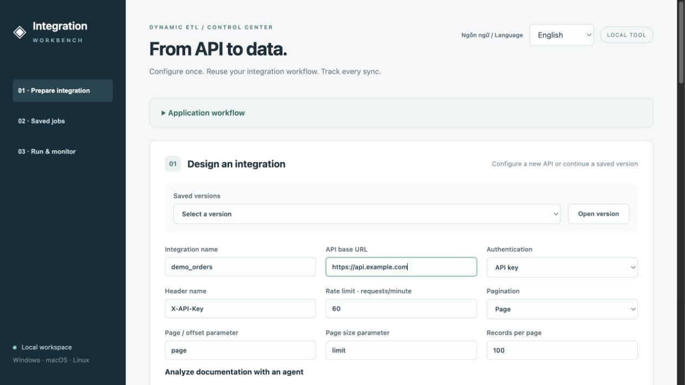
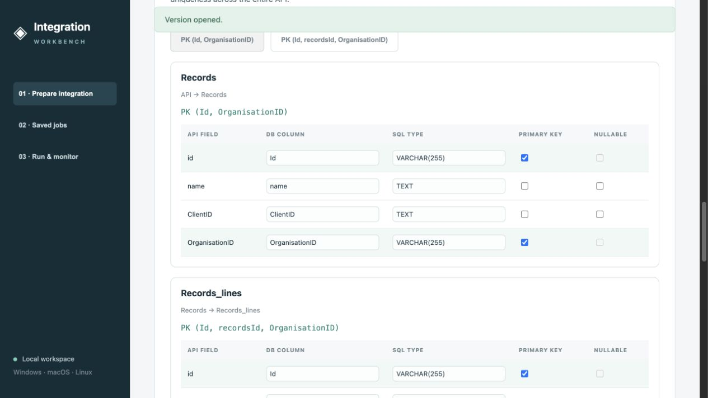
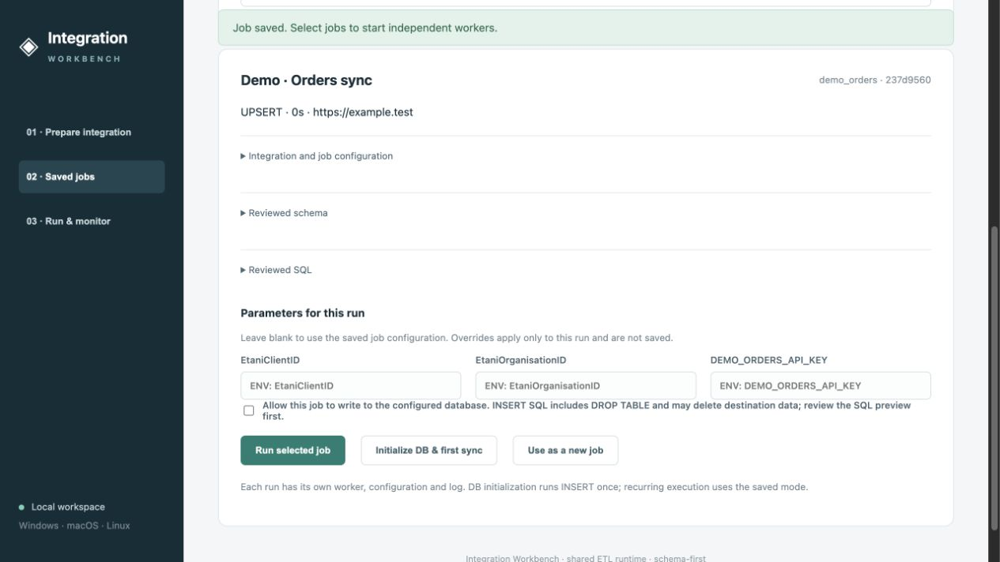
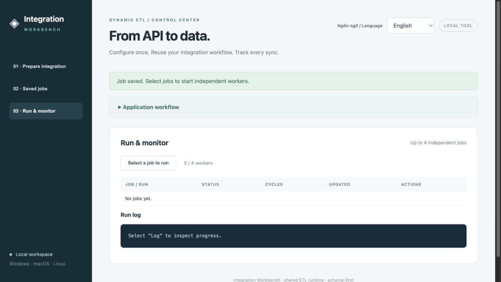
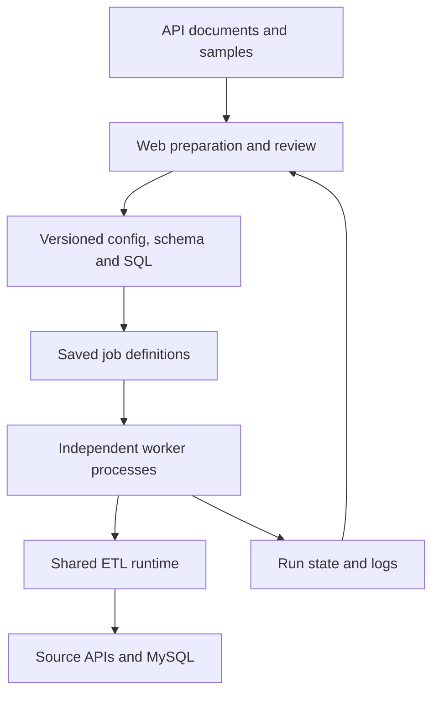

# Integration Workbench

**Turn API documentation and sample data into reviewed integrations, database schemas and reusable sync jobs—from one web interface.**

[Interactive demo](https://Haipt241.github.io/dynamic-etl-framework/demo/) · [Product tour](docs/index.html) · [Vietnamese overview](docs/README.vi.md) · [Setup & technical guide](docs/WEB_TOOL.md)

> I transformed an integration-specific ETL codebase into a reusable web tool for managing API configuration, reviewing database schemas and SQL, saving integration jobs, and monitoring independent runs. The goal is less duplicated code, simpler workflows, and more flexible, convenient integration management while retaining existing business logic.



## What changed

| Previously | Now | Practical benefit |
| --- | --- | --- |
| Configure integrations through scripts and hand-edited JSON | Declare API settings, import documents, or review agent proposals in the browser | Less manual setup and a clearer review process |
| Inspect schema and SQL across separate files | Review tables, columns, types, composite primary keys and SQL together | Catch mapping issues before execution |
| Repeat execution settings for each run | Save a named job pinned to a reviewed integration version | Repeatable operations with less re-entry |
| Operate integrations through individual commands | Select jobs, inspect details, run independent workers and inspect logs | One place to manage integration work |
| Extend integration-specific code for routine variations | Reuse shared authentication, extraction, SQL generation and runtime services | Smaller maintenance surface; custom code reserved for genuinely new behavior |

## What you manage in the interface

| Area | User controls | Output |
| --- | --- | --- |
| **Prepare integration** | Base URL, multiple GET endpoints, authentication, pagination, rate limits, sample data and document import | An integration draft |
| **Agent-assisted review** | Documentation URLs/text, requirements, endpoint selection, editable config and schema, missing-information notes | Reviewed configuration and schema; a configured Claude provider is required |
| **Schema & SQL** | Table/column names, SQL types, nullability, single/composite PKs, nested tables, SQL preview and imported Jinja templates | Versioned `config.json`, `schema.json`, stage/prod/view/procedure SQL |
| **Saved jobs** | Reviewed version, execution mode, client/organisation parameters, environment references and repeat interval | Reusable job definitions |
| **Run & monitor** | Start, initialize DB, stop, inspect status, cycles and logs | Independent worker executions and persisted run history |

The interface supports **English and Vietnamese**. Existing provider adapters and CLI entry points remain available internally; users do not need to choose historical reference integrations in the web tool.

## See the workflow

1. **Describe the API.** Import OpenAPI/Swagger or Postman examples, provide raw samples, or enter endpoints manually. Optionally ask a configured agent to propose config and schema from documentation.
2. **Review the result.** Select endpoints, correct mappings, inspect nested tables and choose primary keys. Missing information needs a human decision.
3. **Review SQL and save a version.** Generate SQL using the shared generator or import an SQL template. Saving a definition does not execute SQL.
4. **Save a job.** Choose the integration version, parameters, mode and repeat interval. Credentials use environment references.
5. **Run and monitor.** Open the saved job, confirm destination writes, start an isolated worker and follow status/logs. Different integration jobs can run concurrently.

### Review tables and composite primary keys



### Inspect a saved job before running it



### Monitor executions in one place



Screenshots show the actual local interface with demonstration configuration. The empty monitoring screen is intentional: no customer API or database was run for these images. The hosted demo separately simulates worker status and logs and labels them as simulations.

## Try it

### Browser demo

The [GitHub Pages demo](https://Haipt241.github.io/dynamic-etl-framework/demo/) reuses the application's HTML, CSS and JavaScript with an isolated, synthetic-data adapter. Publication requires GitHub Pages to be enabled for this repository; see [deployment instructions](docs/DEMO.md).

- Open the sample saved version to inspect multiple endpoints, nested tables, primary keys and pre-generated SQL.
- Select either saved job to inspect its configuration and simulate a run or stop it.
- Browser changes reset on reload. **No backend, vendor API, AI call or database is connected.**
- Custom document analysis, schema-to-SQL regeneration and real execution require the local application. SQL preview rejects edited sample schemas rather than pretending to regenerate SQL.

### Run the full application locally

Requires Python **3.10+**. Clone the current implementation branch:

```sh
git clone --branch cleanup/dynamic-integration-only https://github.com/Haipt241/dynamic-etl-framework.git
cd dynamic-etl-framework
```

macOS / Linux:

```sh
python3 -m venv .venv
.venv/bin/python -m pip install -r requirements.txt
.venv/bin/python run_web.py
```

Windows PowerShell:

```powershell
py -3 -m venv .venv
.venv\Scripts\python.exe -m pip install -r requirements.txt
.venv\Scripts\python.exe run_web.py
```

Open **http://127.0.0.1:8765**. Schema design works without a database. Real execution requires the selected provider's credentials, MySQL/AWS infrastructure and any native database drivers needed by that workflow. Windows execution still requires validation on Windows.

For agent analysis, configure `ANTHROPIC_API_KEY` and `ETL_ANALYSIS_MODEL` in the server environment, or use the existing authenticated Claude CLI. Agent availability is shown in the UI; model usage may incur provider charges. Keep credentials out of documentation, committed files and saved JSON.

## Architecture and reuse



| Folder | Responsibility |
| --- | --- |
| `dynamic_integrations/` | Shared auth, extraction, transformation, schema/SQL generation, database, retry, monitoring and compatibility logic |
| `web/` | Bilingual UI, local HTTP API, definition storage and job management |
| `scripts/` | Operational tools and reproducible static-demo build |
| `tests/` | Automated checks and provider diagnostics |
| `docs/` | User/developer guides, screenshots and static demo |
| `reference/` | Historical comparison material; not imported by the application |
| `var/` | Runtime state, logs and snapshots; not committed |

This refactor retains the 21 existing provider adapters and CLI compatibility. Familiar authentication flows reuse shared implementations; a new authentication protocol or unsupported provider behavior still needs code. There is no claim that every legacy integration has been validated against its live API after the refactor.

## Execution boundaries

- The local manager supports **up to four concurrent worker processes**, with a duplicate guard for the same provider/client/organisation.
- Existing retry, rate-limit and reconciliation logic is reused. There is no separate visual reconciliation dashboard or global cross-worker quota coordinator yet.
- Saved versions/jobs and execution history persist in SQLite. Server crashes mark unfinished runs interrupted; automatic checkpoint recovery is not implemented.
- **INSERT setup SQL may contain `DROP TABLE`.** Review it and use a dedicated destination for validation. Stopping a worker may leave partial writes.
- The server binds to localhost and is a **single-user workbench**, not a hosted multi-tenant service. Public deployment needs authentication, authorization and deployment hardening.
- Offline tests cover application contracts; they do not establish live provider correctness, data completeness or production throughput.

## Validation

```sh
python -m pytest -q tests/test_web_tool.py tests/test_saved_jobs.py tests/test_endpoint_import.py tests/test_document_analysis.py tests/test_repository_layout.py
```

Some other tests are historical diagnostics that require external infrastructure. See [test guidance](tests/README.md).

## Documentation

- [Bilingual user workflow](docs/USER_WORKFLOW.md)
- [Setup, architecture, API routes and limitations](docs/WEB_TOOL.md)
- [Repository layout and compatibility](docs/REPOSITORY_LAYOUT.md)
- [Static demo: build and GitHub Pages deployment](docs/DEMO.md)
- [Existing CLI integration guide](DYNAMIC_INTEGRATIONS_README.md)

The active implementation is on `cleanup/dynamic-integration-only`, reviewed in [PR #1](https://github.com/Haipt241/dynamic-etl-framework/pull/1).
