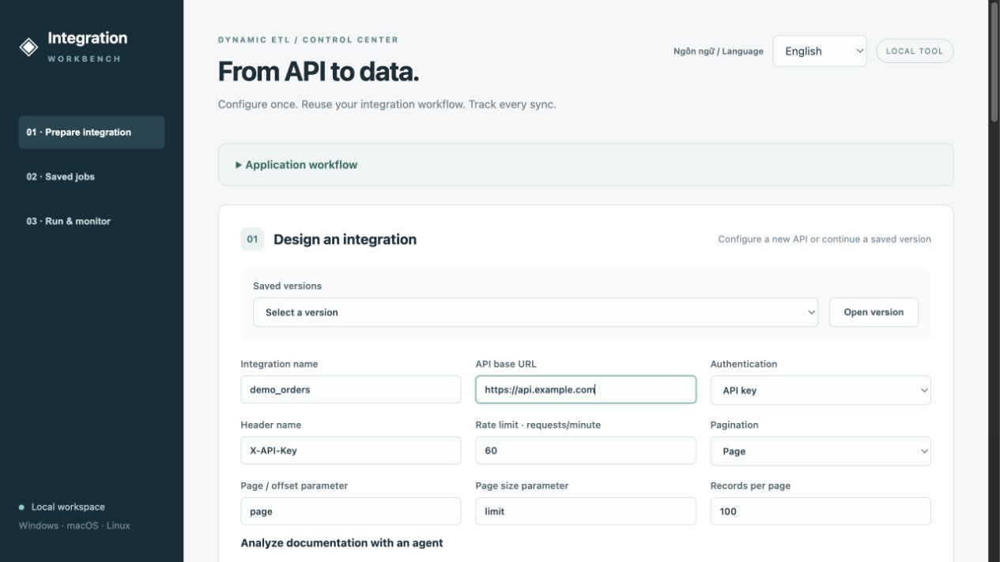
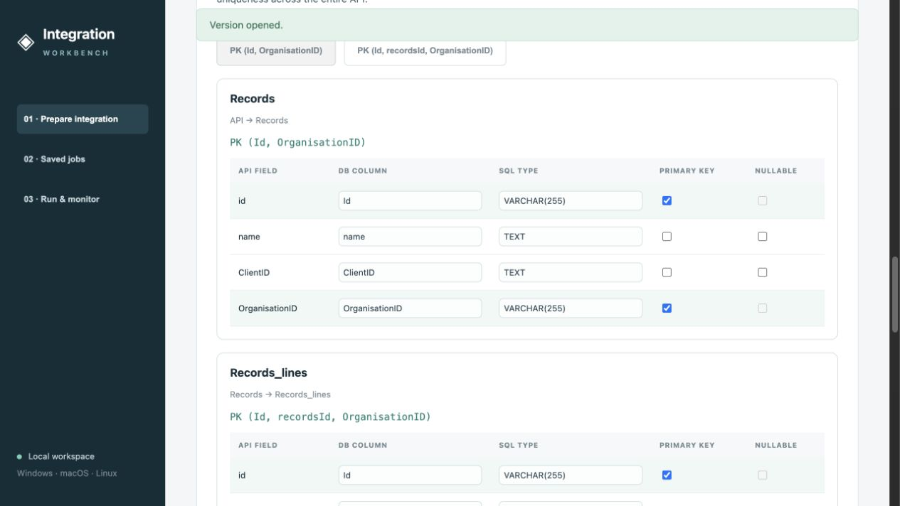
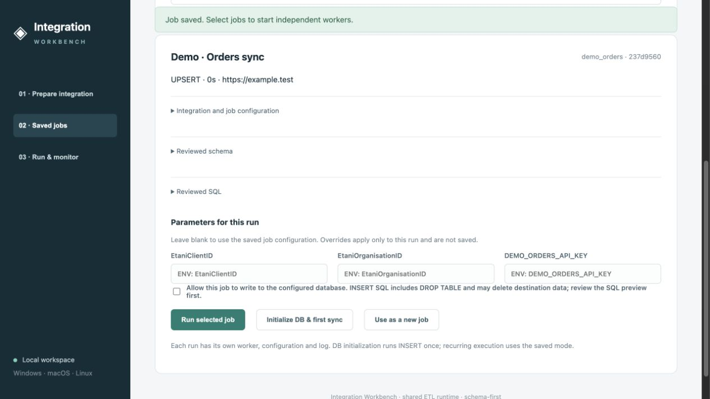

# Integration Workbench — tổng quan tiếng Việt

[English README](../README.md) · [Quy trình đầy đủ](USER_WORKFLOW.md) · [Hướng dẫn chạy](WEB_TOOL.md)

Chuyển từ các script ETL và cấu hình rời rạc sang một công cụ web: khai báo integration, duyệt cấu trúc database và SQL, lưu job để tái sử dụng, chạy nhiều job độc lập và theo dõi kết quả. Mục tiêu là giảm code trùng lặp, đơn giản hoá nghiệp vụ và tăng tính linh hoạt, đồng thời giữ lại logic tích hợp hiện có.

## Ba khu vực chính

| Khu vực | Người dùng làm gì? | Đầu ra |
| --- | --- | --- |
| Chuẩn bị integration | Nhập/import nhiều endpoint; khai báo auth, phân trang, rate limit; đưa tài liệu cho agent; duyệt config/schema, cột, PK ghép, bảng con và SQL | Phiên bản gồm config.json, schema.json, SQL; job được tạo từ phiên bản đã duyệt |
| Job đã lưu | Chọn job, xem cấu hình integration, schema/SQL, tham số và chu kỳ; khởi tạo DB hoặc chạy đồng bộ | Một lần chạy bằng worker riêng |
| Chạy & giám sát | Theo dõi trạng thái, số vòng, log; dừng từng job | Lịch sử chạy và thông tin xử lý lỗi |

## Quy trình

1. Nhập tài liệu API, mẫu JSON hoặc khai báo danh sách endpoint.
2. Phân tích bằng parser có sẵn hoặc agent đã cấu hình; người dùng duyệt config và schema.
3. Chọn bảng/cột/PK, kiểm tra nested extraction, xem SQL hoặc import template.
4. Lưu phiên bản, tạo job gắn với phiên bản đó và tham chiếu credential qua biến môi trường.
5. Chọn job để chạy; xác nhận ghi DB; giám sát từng worker độc lập.

Thiết kế và lưu job chưa ghi dữ liệu vào DB. Khởi tạo DB là một lần chạy INSERT riêng sau khi xác nhận; SQL có thể chứa DROP TABLE.

## Demo và giới hạn

[Demo giao diện](https://Haipt241.github.io/dynamic-etl-framework/demo/) dùng dữ liệu giả lập, không gọi API/AI hay ghi DB. Có thể mở cấu hình mẫu, duyệt bảng/SQL, chọn job và mô phỏng chạy/dừng. Thay đổi mất khi tải lại trang. Phân tích tài liệu và sinh lại SQL cho cấu hình tuỳ chỉnh cần ứng dụng Python chạy local.

Runtime hiện hỗ trợ tối đa bốn worker, tái sử dụng auth/retry/rate-limit/reconcile của hệ thống cũ. Chưa có dashboard reconcile riêng, tự khôi phục checkpoint sau crash hoặc bộ giới hạn quota chung giữa các worker. Công cụ hiện dành cho một người dùng local; chưa phải dịch vụ SaaS đa người dùng.
