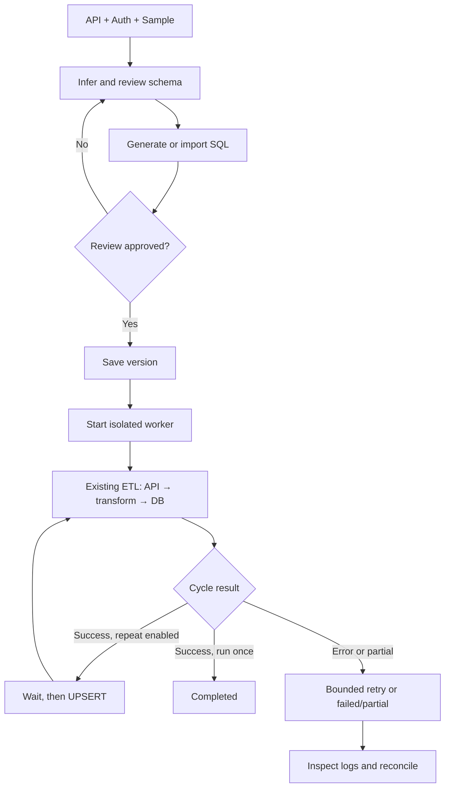

# Quy trình sử dụng / Application workflow

Mở `http://127.0.0.1:8765`, chọn **Tiếng Việt / English** ở đầu trang. Ngôn ngữ được ghi nhớ trên trình duyệt; chuyển ngôn ngữ không làm mất dữ liệu đang nhập.

Open `http://127.0.0.1:8765` and select **Tiếng Việt / English** in the header. The browser remembers your choice; switching languages preserves your current inputs.

Các integration cũ được giữ trong mã nguồn để đối chiếu và kiểm thử nội bộ. Chúng không phải danh sách template để người dùng lựa chọn. **Phiên bản đã lưu / Saved versions** chỉ chứa các cấu hình đã được lưu qua tool.

Legacy integrations are retained in the codebase for internal comparison and regression testing. They are not exposed as selectable templates. **Saved versions** contains configurations previously saved through the tool.

| Bước / Step | Tiếng Việt | English | Kết quả / Result |
| --- | --- | --- | --- |
| 1. API | Nhập tên integration, base URL, endpoint GET, phương thức auth, header, phân trang, rate limit, đường dẫn dữ liệu và mẫu JSON. | Enter the integration name, base URL, GET endpoint, authentication, header, pagination, rate limit, data path and sample JSON. | Bản khai báo API / API definition |
| 2. Phân tích / Analyze | Bấm **Phân tích mẫu**. Object được làm phẳng; mảng object có ID thành bảng con; mảng chưa có khoá giữ JSON text. | Select **Analyze sample**. Objects are flattened; arrays of objects with IDs become child tables; unkeyed arrays remain JSON text. | Schema đề xuất / Proposed schema |
| 3. Duyệt / Review | Kiểm tra tên cột, kiểu SQL, khoá chính, nullable và bảng con. Dùng **Thêm endpoint vào bản nháp** cho API cùng integration. | Review column names, SQL types, primary keys, nullability and child tables. Use **Add endpoint to draft** for more endpoints in the same integration. | Schema đã kiểm tra / Reviewed schema |
| 4. SQL | Bấm **Sinh & xem SQL**, xem stage/prod/view/procedure. Có thể import template SQL rồi sinh lại. | Select **Generate & preview SQL** and inspect stage/prod/view/procedure output. Optionally import a SQL template and regenerate. | SQL để duyệt, chưa ghi DB / SQL for review, no DB writes |
| 5. Phiên bản / Version | Xác nhận đã duyệt schema và SQL, bấm **Lưu phiên bản**. Thay đổi về sau được lưu thành phiên bản mới. | Confirm review and select **Save version**. Later changes are saved as a new version. | Cấu hình cố định cho job / Immutable job definition |
| 6. Thực thi / Execute | Nhập client/organisation, secret và tham số bắt buộc. Chọn INSERT hoặc UPSERT, đặt chu kỳ và xác nhận ghi DB. | Enter client/organisation, secrets and required parameters. Select INSERT or UPSERT, set the interval and confirm DB writes. | Worker riêng / Isolated worker |
| 7. Giám sát / Monitor | Xem trạng thái, số vòng, log; dừng job nếu cần. Sau lỗi hoặc dừng giữa chừng, kiểm tra/đối soát dữ liệu trước khi chạy lại. | Inspect status, cycles and logs; stop a job if needed. After failure or interruption, check/reconcile data before restarting. | Lịch sử thực thi / Execution history |

## Dữ liệu đầu vào / Inputs

| Thông tin / Information | Mục đích / Purpose |
| --- | --- |
| Tên integration / Integration name | Định danh cấu hình và tên bảng / Identify the configuration and tables |
| Base URL + endpoint | Xác định API được gọi / Identify the API to call |
| Auth + header | Chọn cách xác thực; secret nhập khi chạy / Select authentication; enter secrets at runtime |
| Data path | Chỉ ra mảng bản ghi, ví dụ `data.items`; để trống nếu JSON gốc là mảng / Locate the record array, e.g. `data.items`; leave empty for a root array |
| Primary key | Chọn trường định danh ổn định; cần kiểm tra tính duy nhất từ hệ thống nguồn / Choose a stable identity field and verify uniqueness at the source |
| Pagination + page size | Lấy các trang kế tiếp / Retrieve subsequent pages |
| Rate limit | Giới hạn số request mỗi phút theo API / Set the API request budget per minute |
| Sample JSON | Suy luận cấu trúc; không chứng minh dữ liệu đầy đủ / Infer structure; does not prove data completeness |
| Client/organisation + credentials | Xác định đích ghi và quyền API khi chạy / Select destination context and API credentials at runtime |

## Luồng thực thi / Execution flow

## Hành vi cần biết / Operational behavior

- **INSERT** dùng SQL đã duyệt để khởi tạo rồi đồng bộ. Generator hiện tại có `DROP TABLE`; có thể xoá dữ liệu bảng đích. **UPSERT** dùng cấu trúc đã có. / **INSERT** executes reviewed setup SQL, then syncs. The existing generator includes `DROP TABLE`, which can delete destination data. **UPSERT** uses the existing structure.
- Chu kỳ `0` chạy một lần; chu kỳ lặp tối thiểu 10 giây, tính từ khi vòng trước kết thúc. Sau INSERT thành công, vòng tiếp theo dùng UPSERT. / Interval `0` runs once; repeated cycles wait at least 10 seconds after the previous cycle finishes. After a successful INSERT, later cycles use UPSERT.
- Tối đa 4 job độc lập; chặn chạy trùng integration/client/organisation. / Up to 4 independent jobs; duplicate provider/client/organisation jobs are blocked.
- Đóng tab không dừng job; tắt server sẽ dừng job. Khi server khởi động lại, job dở dang được đánh dấu interrupted, không tự phục hồi từ trang API cuối cùng. / Closing the tab does not stop jobs; shutting down the server does. After restart, unfinished jobs are marked interrupted, without automatic page-level recovery.
- Reconciliation dùng logic runtime hiện có; chưa có màn hình đối soát riêng hoặc bằng chứng tự động rằng mọi dữ liệu API đã được lấy đủ. / Reconciliation uses existing runtime logic; there is no dedicated reconciliation screen or independent automatic proof of source completeness yet.
- Form thông thường hỗ trợ GET và bốn kiểu auth cơ bản. OAuth hoặc auth đặc thù cần cấu hình nâng cao tương thích; phương thức auth chưa được runtime hỗ trợ cần bổ sung code. / The standard form supports GET and four basic auth modes. OAuth/custom auth requires compatible advanced configuration; unsupported authentication methods require runtime code.
- Ngôn ngữ UI đổi được, còn tên trường API, giá trị cấu hình, SQL và log kỹ thuật giữ nguyên để đối chiếu chính xác. / UI language can change; API field names, configuration values, SQL and technical logs remain unchanged for accurate diagnosis.
